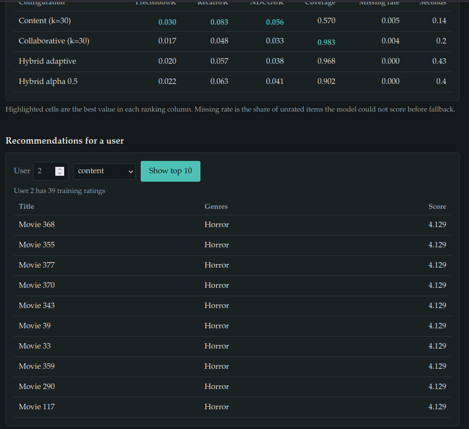
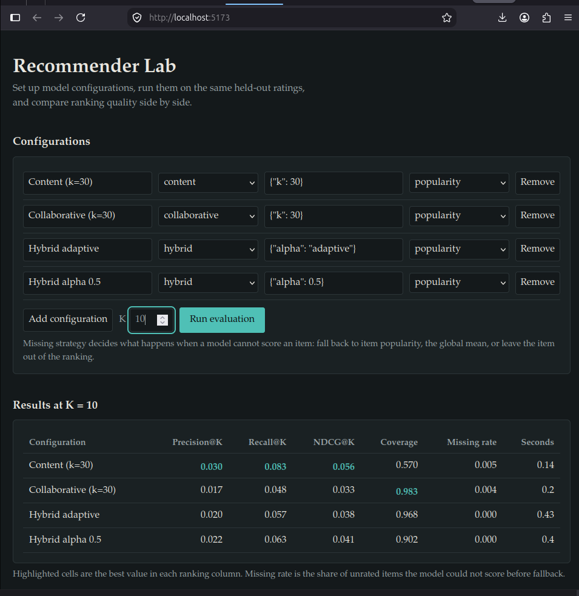

# Recommender Lab: Recommendation Evaluation & Experimentation Platform

Compare content-based, collaborative and hybrid recommenders on the same held-out ratings, with ranking metrics, explicit handling of missing predictions, and stored experiment history.

Builds on my CineXplain hybrid movie recommender, and turns its ideas into a reusable experimentation tool.

## What it does

- Compares **content-based**, **collaborative** and **hybrid** models (plus a popularity baseline).
- Calculates **Precision@K, Recall@K, NDCG@K**, plus item coverage and missing-prediction rate.
- Handles missing predictions with three strategies: `popularity`, `global_mean`, `drop`.
- Compares different **model configurations** side by side (k neighbours, fixed vs adaptive alpha, min overlap).
- Shows **recommendation results** per user, including the collaborative weight alpha used.
- Persists every run to SQLite (`/api/experiments`).

## Architecture

```
React (Vite)  ──/api──▶  FastAPI  ──▶  models.py (scikit-learn + NumPy)
                           │            evaluate.py + metrics.py
                           └──▶  data.py (Pandas, SQLite/SQL)
```

| Component | Technology |
|---|---|
| Recommendation models | Python, scikit-learn |
| Data processing | Pandas, SQL (SQLite) |
| Backend | FastAPI |
| Frontend | React |
| Evaluation | Precision@K, Recall@K, NDCG@K |

## Models

- **Content-based**: TF-IDF vectors over movie genres, cosine item-item similarity. A prediction is the similarity-weighted average of the user's ratings on the item's top-k most similar rated items.
- **Collaborative**: item-based CF. Cosine similarity over user-mean-centred rating columns; similarities backed by fewer than `min_overlap` co-raters are zeroed.
- **Hybrid**: `score = alpha * CF + (1 - alpha) * CB`. With `alpha: "adaptive"`, `alpha_u = n_u / (n_u + c)`, so users with few ratings lean on content, and users with many ratings lean on collaborative signal.
- **Popularity**: smoothed item mean, used as a baseline and as a fallback.

## Missing predictions

A model returns `NaN` when it has no evidence for an item (no similar rated neighbours, or too little co-rating overlap). Handling:

1. Hybrid: if CF is missing use CB, if CB is missing use CF.
2. If still missing, apply the chosen strategy: `popularity` (smoothed item mean, ranked just below real predictions), `global_mean`, or `drop` (item is not ranked).
3. The **missing rate** (share of unrated items a model couldn't score) is reported in every evaluation so strategies can be compared honestly.

## Evaluation protocol

- Per-user random holdout: 20% of each user's ratings go to test (users with under 5 ratings stay in train). No train/test leakage (covered by a test).
- An item is **relevant** if its held-out rating is >= 4.
- Candidates are all items the user hasn't rated in train; already-rated items are never recommended.
- Metrics are averaged over users with at least one relevant test item.

## Run it

```bash
# backend
cd backend
python -m venv .venv && source .venv/bin/activate
pip install -r requirements.txt
uvicorn app.main:app --reload          # http://localhost:8000/docs

# frontend (new terminal)
cd frontend
npm install && npm run dev             # http://localhost:5173

# tests
cd backend && python -m pytest
```

Data: with no files present, a synthetic genre-driven dataset is generated. For real data, place MovieLens `ratings.csv` and `movies.csv` in `data/` (see `data/README.md`).

### API

| Endpoint | Purpose |
|---|---|
| `POST /api/evaluate` | Run a list of configurations at a given K |
| `GET /api/recommend/{user_idx}?model=hybrid&k=10` | Top-K recommendations |
| `GET /api/experiments` | Stored experiment history |
| `GET /api/users` | Per-user activity (SQL aggregate) |

```json
{"k": 10, "configs": [
  {"name": "Hybrid adaptive", "type": "hybrid", "params": {"alpha": "adaptive", "c": 15}},
  {"name": "CF k=50", "type": "collaborative", "params": {"k": 50}, "missing": "drop"}]}
```

## Results

Results below use the built-in synthetic dataset (genre-driven ratings). Swap in MovieLens to report real-world numbers.





## Limitations and next steps

- Random per-user holdout; a temporal split would be more realistic.
- Dense similarity matrices: fine for MovieLens-small, would need sparse/ANN methods at scale.
- Next: matrix factorization (SVD/ALS) model, cross-validation with confidence intervals, A/B-style significance tests.
